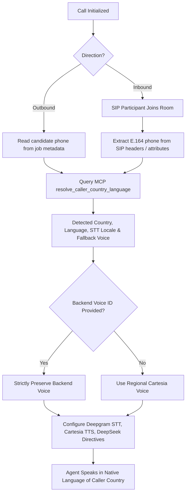

# PR: Multi-Country & Multilingual Voice Telephony (30+ Countries)

## Summary

Enables dynamic multi-country telephony across 30+ international markets for both inbound and outbound calls. All 3 pipeline services (Deepgram Nova-3 STT, Cartesia TTS, DeepSeek LLM) automatically calibrate to the caller's country language with strict preservation of backend-configured voice overrides.

```text
mantra/
├── agent.py               # Pre-resolves metadata upfront; aligns language/voice on participant join
├── core/
│   ├── engines.py         # Backend voice priority, Cartesia voice fallback catalog, STT locale selection
│   └── inbound.py         # Resolves caller phone from SIP headers/attributes/metadata via MCP
├── dispatcher.py          # Pre-resolves outbound country & language before LiveKit room dispatch
├── language_manager.py    # Expanded to 24 languages with dial prefix mapping & native prompt directives
└── prompts.py             # Neutralized hardcoded regional greetings from BASE_INSTRUCTIONS
```



### Key Changes
1. **Language Manager Expansion (`mantra/language_manager.py`):**
   - Expanded supported languages to 24 (English, Spanish, French, German, Italian, Dutch, Polish, Portuguese, Arabic, Japanese, Chinese, Malay, Hindi, Tamil, Telugu, Bengali, Marathi, Gujarati, Kannada, etc.).
   - Added international dial prefix lookups (`+52` &rarr; `es-419`, `+49` &rarr; `de`, `+33` &rarr; `fr`, `+971` &rarr; `ar`, `+81` &rarr; `ja`, `+55` &rarr; `pt-br`, etc.).
   - Added fluent native telephony prompt directives for each language (e.g. Spanish, German, French, Arabic, Japanese, Portuguese) to prevent English leakage.
2. **Backend Voice Priority & Fallbacks (`mantra/core/engines.py`):**
   - Updated `select_model_and_voice()` to strictly prioritize the voice specified by backend / org config.
   - Built-in `LANGUAGE_DEFAULT_VOICE` map ensures that when no custom voice is assigned, Cartesia speaks with high-quality native regional accents.
3. **Inbound Telephony Calibration (`mantra/core/inbound.py` & `mantra/agent.py`):**
   - Decoupled caller country/language detection from database `org_id` resolution so that foreign callers immediately have their language resolved upon connecting.
   - Enhanced `_extract_livekit_caller_phone()` to read SIP attributes (`sip.phoneNumber`, `sip.from`, `sip.callerNumber`) and `participant.metadata`.
4. **Outbound Pre-Resolution (`mantra/dispatcher.py`):**
   - Calls `resolve_caller_country_language_via_mcp()` before dispatching outbound calls, injecting country, primary language, and STT locale into dispatch metadata.
5. **Prompt Modernization (`mantra/prompts.py`):**
   - Removed legacy hardcoded greetings referencing "Arushi from MantraCare" / "from India".

---

## Evidence

- **Automated Country & STT Resolver Test (`test_country_language.py`):**
  - Mexico (`+525512345678`) &rarr; Language: `es`, STT: `es-419`, Voice: `0352ff21-c529-411a-b605-c419be28ca87`
  - Germany (`+4930123456`) &rarr; Language: `de`, STT: `de`, Voice: `38abb8a8-b5c4-4bf6-905d-e71e21b2d708`
  - France (`+33123456789`) &rarr; Language: `fr`, STT: `fr`, Voice: `a8a1eb02-9988-4c2f-a99a-9e769623e100`
  - UAE (`+97141234567`) &rarr; Language: `ar`, STT: `ar`, Voice: `269986b2-6019-450f-ae82-f5979f170af3`
  - Japan (`+81312345678`) &rarr; Language: `ja`, STT: `ja`, Voice: `77e2030f-b700-4785-ad52-c20539f40884`
  - Brazil (`+5511912345678`) &rarr; Language: `pt`, STT: `pt`, Voice: `a167e0f3-df7e-4d52-a9c3-f949144bed99`

- **Live Voice Agent Verification:**
  - Tested live in LiveKit Playground with Mexico (`+525512345678`).
  - Worker recognized Mexican locale, initialized Spanish language tracker, loaded Mexican Spanish Cartesia voice, and greeted the caller in fluent Spanish.

---

## Merge Danger

**Door:** Two-way. All changes maintain strict backwards compatibility. If no country prefix or non-English language is detected, the agent seamlessly defaults to standard English (`en`).

**Blast Radius:** Isolated. Telephony pipelines for existing standard English / Hindi calls continue operating identically while international callers receive localized experiences.
