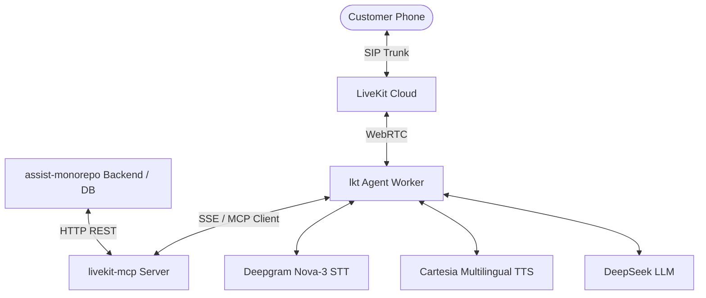

# Feature: Multi-Country & Multilingual Telephony (30+ Countries)

[[00 Antigravity Hub]] | [[00 Indice de Memoria]] | [[Proyecto: lkt]]

## 1. Executive Summary

This feature equips the LiveKit Voice Agent platform (`lkt`), FastMCP microservice (`livekit-mcp`), and backend (`assist-monorepo`) with automated multi-country and multilingual capabilities spanning 33+ international markets.

When calls are initiated (outbound) or received (inbound), the system parses the caller or destination phone number, queries MCP for country and language resolution, and aligns the 3 core AI pipeline engines:
1. **STT:** Deepgram Nova-3 configured with regional locale (e.g., `es-419`, `de`, `fr`, `ar`, `ja`, `pt-br`, `multi`).
2. **TTS:** Cartesia multilingual engine with regional voice fallback (e.g. Mexican Spanish, German, French, Brazilian Portuguese, Japanese, UAE Arabic).
3. **LLM:** DeepSeek prompt directives enforcing strict conversational fluency in the native language.

---

## 2. Telephony Lifecycles

### Outbound Call Lifecycle
1. Backend (`assist-monorepo`) sends dispatch metadata: `{"phone_number": "+525512345678", "direction": "outbound"}`.
2. `lkt` entrypoint resolves candidate phone prior to WebRTC track connection.
3. `lkt` calls `resolve_caller_country_language` via `livekit-mcp`.
4. MCP returns ISO code (`MX`), language (`es`), STT locale (`es-419`), and Cartesia voice ID.
5. `lkt` checks for backend voice override. If present, it preserves backend voice; otherwise, it assigns the regional voice.
6. DeepSeek KV prefix cache is pre-warmed with the Spanish prompt.
7. Agent begins speaking in fluent native Spanish upon customer answer.

### Inbound Call Lifecycle
1. Customer dials inbound DID from their local phone (`+525512345678`).
2. LiveKit SIP Trunk receives call and triggers dispatch rule.
3. SIP participant joins room with identity `sip_+525512345678` or SIP attributes (`sip.phoneNumber`).
4. `agent.py` intercepts caller ID and calls `livekit-mcp`.
5. MCP resolves country (`MX`) and language (`es`).
6. `agent.py` dynamically updates TTS language & voice, resets language hysteresis tracker, updates system prompt directive, and greets the caller in Spanish.

---

## 3. Architecture & Data Flow

---

## 4. Operational Guarantees

1. **Backend Voice Priority:** Voices configured in tenant DB take absolute precedence; MCP catalog voices serve strictly as fallbacks.
2. **Offline Resilience:** If the backend database is unreachable, `livekit-mcp` utilizes an internal 33-country catalog. If MCP is offline, `lkt` falls back to its internal dial prefix table.
3. **Decoupled Client Recognition:** Country and language detection executes immediately without depending on `org_id` resolution, ensuring zero greeting latency for foreign callers.

---

## 5. Linked References
- [[Architecture/MCP System Overview]]
- [[Features/Voice Agent]]
- [[Features/Telephony Integration]]
- [[00_Agente/Memorias/Multi-Country Telephony Architecture]]
